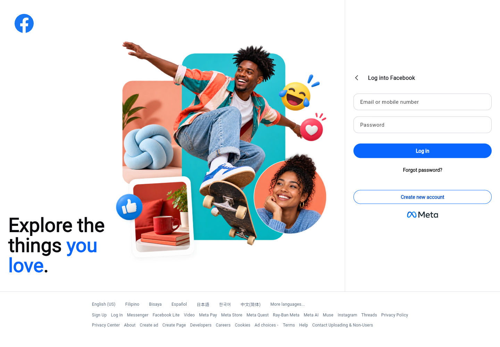

# Facebook Replicate

A static Facebook login page replica built with Flutter for web. The desktop layout pairs a social image collage with the login form and footer links. Smaller screens show the login panel above the collage.

## Screenshot



## About this project

This is a UI practice project. The fields accept text, but the login, password recovery, and account creation buttons are placeholders. It does not authenticate users or submit credentials.

This project is not affiliated with Facebook or Meta. Brand names and graphics belong to their respective owners.

## Run locally

Install Flutter with a bundled Dart SDK compatible with `pubspec.yaml` (Dart 3.4 or newer, below 4.0), then run:

```sh
flutter pub get
flutter run -d chrome
```

## Checks

```sh
flutter analyze
flutter test
```

## Build for web

```sh
flutter build web
```

The output is generated in `build/web/`.
